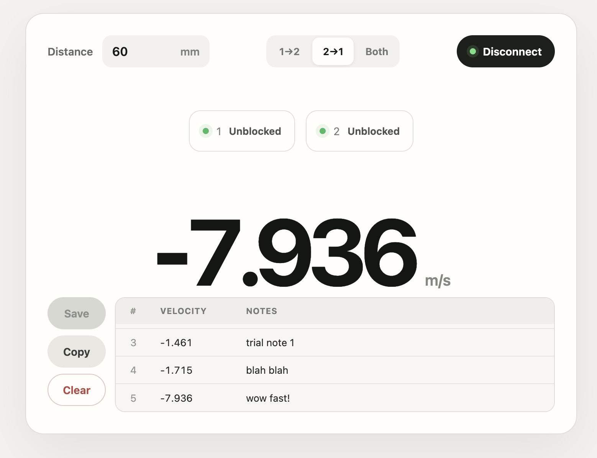

# Beam Velocity Web UI

Web GUI for collecting velocity data using five IR beambreak sensors.

[https://qwertpas.github.io/beamvel/](https://qwertpas.github.io/beamvel/)

Choose the upward direction, then enable **Vertical** and **Up & down** to fit a
throw and return across two to five sensors. The reading is the speed at first
sensor contact.

Save trials, then use **Copy** or **Export CSV**. The last column estimates the
first sensor crossing in UTC.
